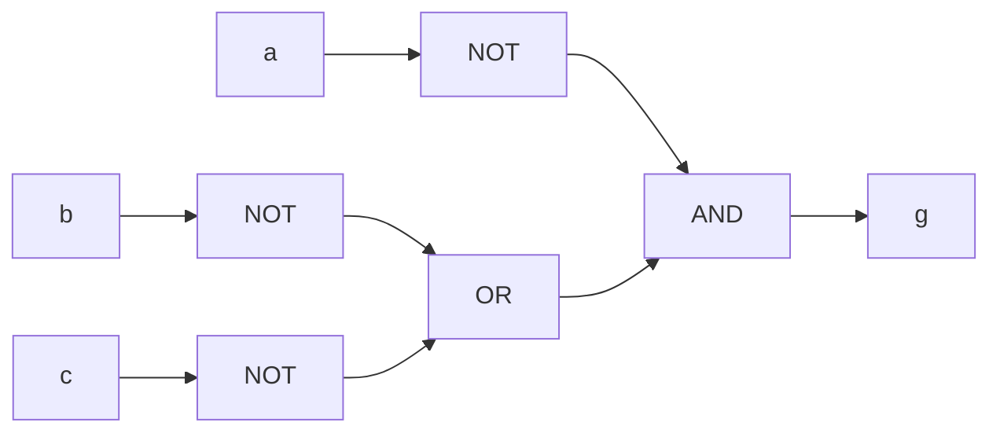

# Ejercicio 3 — Funciones combinacionales

En SystemVerilog, AND se escribe `&`, OR se escribe `|` y NOT se escribe `~`.
El módulo `guia1_ej3` implementa las tres funciones originales y expone también
sus versiones simplificadas para compararlas.

## Tabla de verdad

Las versiones originales y simplificadas tienen la misma tabla:

| a | b | c | f | g | h |
|---|---|---|---|---|---|
| 0 | 0 | 0 | 0 | 1 | 0 |
| 0 | 0 | 1 | 0 | 1 | 0 |
| 0 | 1 | 0 | 0 | 1 | 0 |
| 0 | 1 | 1 | 1 | 0 | 0 |
| 1 | 0 | 0 | 1 | 0 | 0 |
| 1 | 0 | 1 | 1 | 0 | 1 |
| 1 | 1 | 0 | 1 | 0 | 0 |
| 1 | 1 | 1 | 1 | 0 | 1 |

## Simplificaciones

Se usa `+` para OR, `·` para AND y `¬` para NOT.

### f(a,b,c) = a·b + a·¬b + ¬a·b·c

```text
f = a·(b + ¬b) + ¬a·b·c            Distributiva
  = a·1 + ¬a·b·c                   Complemento
  = a + ¬a·(b·c)                   Identidad y asociatividad
  = (a + ¬a)·(a + b·c)             Distributiva
  = 1·(a + b·c)                    Complemento
  = a + b·c                        Identidad
```

### g(a,b,c) = ¬(a + b·c)

```text
g = ¬a·¬(b·c)                      De Morgan sobre el OR
  = ¬a·(¬b + ¬c)                   De Morgan sobre el AND
```

Las negaciones afectan solamente variables. El circuito original conecta
`b` y `c` a una AND, su salida y `a` a una OR y luego a una NOT.
La segunda implementación es:



### h(a,b,c) = (a+b)·(a+¬b)·(¬a+c)

```text
h = (a + b·¬b)·(¬a + c)            Distributiva: (x+y)·(x+z) = x+y·z
  = (a + 0)·(¬a + c)               Complemento
  = a·(¬a + c)                     Identidad
  = a·¬a + a·c                     Distributiva
  = 0 + a·c                        Complemento
  = a·c                            Identidad
```

## Simulación

Desde esta carpeta:

```sh
make sim
make wave
make clean
```

Desde la raíz del repositorio:

```sh
make sim GUIA=guia_1 EJ=ej3
```

El testbench recorre las ocho entradas y compara las seis salidas con la tabla
de verdad. También imprime la tabla para poder revisarla en la terminal.

Para HDL Studio, agregar `guia_1_ej3.sv` y seleccionar `guia1_ej3` como módulo
superior. Excluir `guia_1_ej3_tb.sv`.
